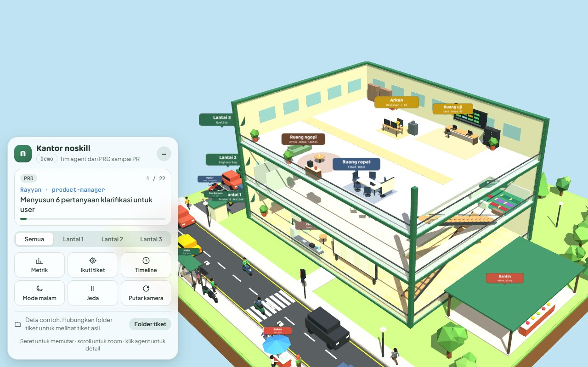
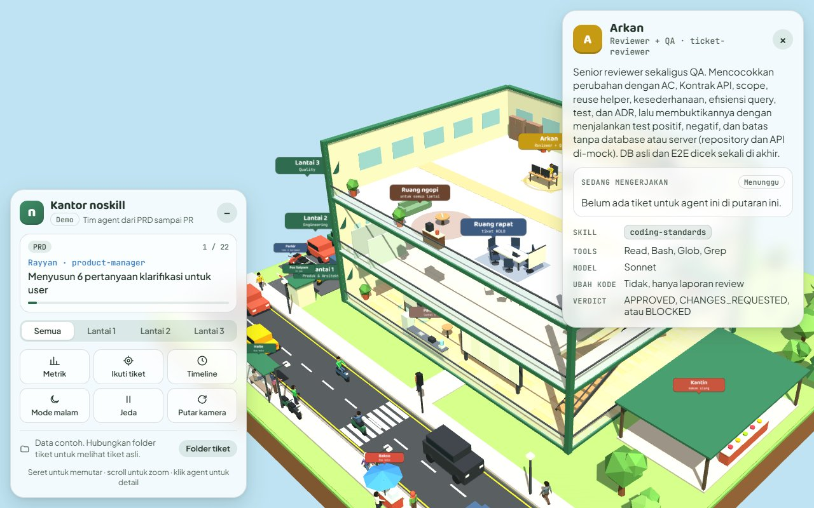
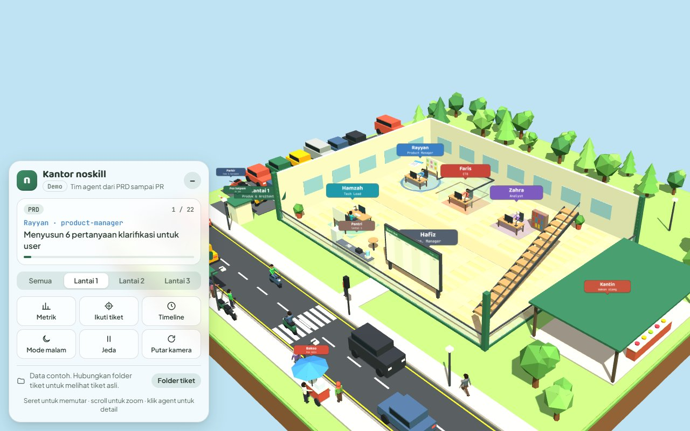
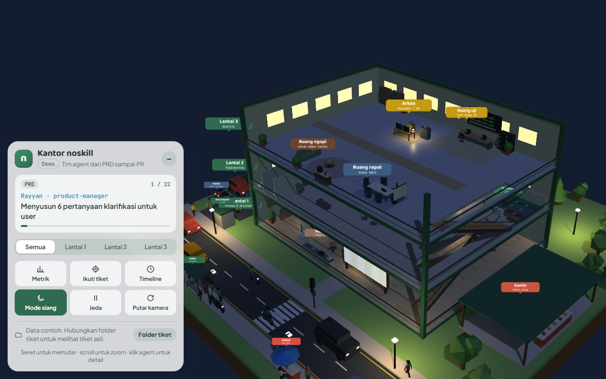

<p align="center">
  <picture>
    <source media="(prefers-color-scheme: dark)" srcset="docs/logo-wordmark-dark.svg">
    
  </picture>
</p>

# noskill

<div align="center">
  
</div>

Koleksi Claude Skills & Agent untuk kerja development sehari-hari — dipaketkan sebagai plugin `noskill`, termasuk tim engineering lengkap dalam bentuk agent: Product Manager, CTO, analyst, tech lead, developer backend/frontend, dan reviewer (sekaligus QA).

📖 **Dokumentasi lengkap:** [awahids.github.io/noskill](https://awahids.github.io/noskill/) (sumber: [`docs/index.html`](docs/index.html)) — cara install, cara kerja alur tiket, semua skill & agent.

## Kantor noskill

`/noskill:kantor` membuka kantor 3D tempat agent noskill bekerja: tiga lantai, board tiket live dari `docs/noskill`, agent semi-realistis yang berjalan mengantar tiket, Ruang uji tempat Arkan (Reviewer + QA) memverifikasi tiket, dan suasana kantor di sekitarnya. Panelnya menampilkan langkah yang sedang berjalan, pemilih lantai, dan toolbar (metrik, ikuti tiket, timeline, mode malam).



| Klik agent untuk melihat tugas dan skill | Jalan raya, halte, dan warga sekitar | Mode malam |
|---|---|---|
|  |  |  |

## Skills

Penjelasan detail tiap skill (kapan dipakai, langkah kerja, hasil, aturan penting): **[awahids.github.io/noskill/skills.html](https://awahids.github.io/noskill/skills.html)** (sumber: [`docs/skills.html`](docs/skills.html)).

Yang muncul di menu `/`: `feature-flow`, `tiket`, `lazy`, `kantor`, `project-profile`, `prd-writer`, dan `debug-assistant`. Skill bertanda *internal* dipakai otomatis oleh agent dan orkestrator, jadi tidak muncul di daftar user-facing.

| Skill | Fungsi |
|---|---|
| [`feature-flow`](skills/feature-flow/) | Orkestrator (engineering manager), alur ramping ala superpowers: plan → developer BE/FE → reviewer (review + verifikasi) → DONE (atau BUG/HOLD) → cek akhir. PRD/CTO/BRD hanya bila diminta, paralel, multi-repo, branch dan PR |
| [`ticket-workflow`](skills/ticket-workflow/) *internal* | Format file tiket, arti tiap status, aturan transisi, verdict agent, dan board |
| [`project-profile`](skills/project-profile/) | Scan repo sekali → `docs/noskill/project-profile.md` (stack, command, struktur, helper, aturan) yang dibaca semua agent |
| [`tiket`](skills/tiket/) | Shortcut tiket dalam satu perintah: lihat board, lanjutkan tiket dari sesi sebelumnya, bug fix lewat satu tiket, rapikan tiket lama atau review ulang tiket DONE |
| [`kantor`](skills/kantor/) | Shortcut: buka **Kantor noskill**, kantor 3D tiga lantai tempat agent noskill bekerja dan berjalan mengantar tiket, live dari tiket `docs/noskill` (lewat artifact claude.ai) |
| [`lazy`](skills/lazy/) | Shortcut: kerjakan langsung dengan solusi paling sederhana, tanpa tiket/review/QA |
| [`prd-writer`](skills/prd-writer/) | PRD baku dengan diagram Mermaid, didahului minimal 5 pertanyaan klarifikasi; juga Reverse-PRD dari kode |
| [`erp-requirements`](skills/erp-requirements/) *internal* | ERP/WMS: (A) checklist desain domain — master data, stock ledger, workflow status, RBAC, audit trail, roadmap MVP; (B) rantai requirement traceability |
| [`task-breakdown`](skills/task-breakdown/) *internal* | PRD/BRD → tiket: satu per endpoint (BE, dengan Kontrak API), per fitur (FE), atau per bug |
| [`coding-standards`](skills/coding-standards/) *internal* | Naming, struktur folder, ORM, API, dokumentasi Swagger/OpenAPI, TDD, quality gate, dan checklist review untuk NestJS/Laravel/Golang/Vue/Next.js |
| [`ticket-implementation`](skills/ticket-implementation/) *internal* | Prosedur bersama ketiga agent developer: scope, reuse, rencana, test RED, quality gate, laporan |
| [`debug-assistant`](skills/debug-assistant/) | Debugging terstruktur: reproduce → isolasi → root cause → fix → verifikasi dengan bukti |

### Plugin tambahan `noskill-extras` (opsional)

Skill di luar alur tiket dipisah ke plugin sendiri supaya plugin inti tetap ringkas. Pasang hanya kalau perlu (lihat [Cara install](#cara-install)).

| Skill | Fungsi |
|---|---|
| [`user-guide`](extras/skills/user-guide/) | Panduan pengguna non-teknis per role dan per fitur |
| [`mockup-prototype`](extras/skills/mockup-prototype/) | Mockup/prototype UI dari PRD, per layar dan per role, termasuk state loading/kosong/error |
| [`standup-update`](extras/skills/standup-update/) | Standup harian atau laporan mingguan, dibaca dari Riwayat tiket |
| [`freelance-proposal`](extras/skills/freelance-proposal/) | Proposal project per fase dengan harga Rupiah dan syarat pembayaran |

## Agent

Dipanggil oleh `feature-flow`. Tiap agent memuat skill yang relevan lewat field `skills:`.

Semua agent bekerja sebagai **senior dengan prinsip lazy**: memutuskan sendiri dari kode dan dokumen, bertanya hanya kalau jawabannya mengubah hasil, dan memilih perubahan terkecil yang memenuhi kebutuhan (PRD sebatas MVP, tiket hanya untuk yang diminta, kode tanpa abstraksi atau poles yang tidak diminta). Validasi, keamanan, dan test tidak pernah dipangkas.

| Agent | Peran | Skill yang dimuat | Bisa ubah kode? |
|---|---|---|---|
| [`product-manager`](agents/product-manager.md) | Product Manager: menyusun pertanyaan klarifikasi, lalu menulis PRD (atau Reverse-PRD dari kode) | `prd-writer`, `erp-requirements` | Tidak (hanya tulis PRD) |
| [`cto`](agents/cto.md) | CTO: review arsitektur setelah PRD (ADR, GO / GO_WITH_NOTES / NO_GO) dan sign-off akhir seluruh branch (SIGN_OFF / CONCERNS) | `coding-standards` | Tidak (hanya tulis ADR & laporan) |
| [`brd-tracer`](agents/brd-tracer.md) | PRD → BR/PROC/US/AC/TECH/TC di `docs/noskill/01..05` | `erp-requirements` | Tidak (hanya tulis dokumen) |
| [`task-planner`](agents/task-planner.md) | Permintaan (atau PRD/BRD di mode lengkap) → tiket `docs/noskill/tickets/*.md` status TODO, sesedikit mungkin | `task-breakdown`, `ticket-workflow` | Tidak (hanya tulis tiket) |
| [`backend-developer`](agents/backend-developer.md) | Tiket `layer: be` — API, service, migration (NestJS/Laravel/Go) | `ticket-implementation`, `coding-standards` | Ya |
| [`frontend-developer`](agents/frontend-developer.md) | Tiket `layer: fe` — halaman, komponen, state (Vue/Next.js) | `ticket-implementation`, `coding-standards` | Ya |
| [`developer`](agents/developer.md) | Fullstack: tiket tanpa `layer` (monolith, mobile, script, tiket lama) | `ticket-implementation`, `coding-standards` | Ya |
| [`ticket-reviewer`](agents/ticket-reviewer.md) | Review + QA dalam satu agent: cek perubahan sesuai AC, Kontrak API & standar, **dan** jalankan test tanpa DB + Cara Verifikasi (positif/negatif/batas) → APPROVED / CHANGES_REQUESTED / BLOCKED | `coding-standards`, `ticket-workflow` | Tidak |

## Aturan inti yang selalu aktif

Plugin ini memasang hook `SessionStart` di [`hooks/hooks.json`](hooks/hooks.json). Saat sesi baru dimulai, hook memanggil wrapper startup yang memuat aturan kerja utama dari [`hooks/core-rules.md`](hooks/core-rules.md) dan konteks tambahan dari [`hooks/startup-extra.md`](hooks/startup-extra.md).

Selain itu, hook `UserPromptSubmit` di [`hooks/hooks.json`](hooks/hooks.json) juga mendeteksi intent prompt dan memberi rekomendasi skill paling relevan. Contoh:

- fitur baru → `/noskill:feature-flow`
- bug/error → `/noskill:tiket fix`
- lanjutan kerja → `/noskill:tiket lanjut`
- tugas umum → `/noskill:lazy`

Ini adalah smart suggestion / intent routing. Hook tidak otomatis mendaftarkan slash command atau memaksa eksekusi skill di luar runtime yang memang mendukung dispatch command. Skill tetap di-register oleh plugin system, dan user tetap memegang kontrol.

### Bahasa

Instruksi di dalam skill, agent, dan hook ditulis dalam bahasa Inggris karena lebih hemat token (±20–40% lebih sedikit dari versi bahasa Indonesia). Semua yang dibaca pengguna tetap berbahasa Indonesia: jawaban, prompt, dan hasil kerja.

## Folder hasil

Semua dokumen yang dihasilkan (PRD, BRD `01..05`, tiket, profil project) ditulis ke `docs/noskill/` secara default. Untuk mengganti, buka `/config` dan ubah opsi **Folder dokumen noskill** milik plugin.

```json
{ "pluginConfigs": { "noskill@noskill": { "options": { "docs_dir": "docs" } } } }
```

Pengaturan ini berlaku untuk semua project di komputer itu.

## Shortcut

| Perintah | Fungsi |
|---|---|
| `/noskill:tiket` atau `/noskill:tiket board` | Tampilkan board tiket, pertanyaan tiket HOLD, dan durasi tiap tahap per tiket |
| `/noskill:tiket fix <deskripsi>` | Bug fix atau perubahan kecil lewat satu tiket |
| `/noskill:tiket lanjut [jawaban]` | Lanjutkan tiket yang tertunda dari sesi sebelumnya |
| `/noskill:tiket rapikan [ID]` | Rapikan tiket TODO/HOLD agar sesuai aturan tiket terbaru (gabung tiket per layer, lengkapi Kontrak API, `integrates_with`, `complexity`); usulan ditampilkan dulu, diterapkan setelah kamu setujui |
| `/noskill:tiket rapikan review <ID>` | Review ulang kode tiket DONE; temuan jadi tiket BUG baru |
| `/noskill:lazy <permintaan>` | Lazy senior dev mode: langsung kerjakan solusi paling sederhana dan terpendek yang jalan (YAGNI, stdlib dulu, tanpa abstraksi), tanpa tiket/review/QA |
| `/noskill:feature-flow` | Alur tiket (default: plan langsung; PRD/BRD bila diminta) |
| `/noskill:project-profile` | Buat/refresh profil project |

## Alur pemakaian

Panggil `/noskill:feature-flow` lalu jelaskan pekerjaannya.

- **Mode default** — semua pekerjaan, kecil maupun besar. Orkestrator menulis tiket langsung dari permintaan (≤ 3 tiket sendiri, lebih banyak lewat `task-planner`) dengan AC positif & negatif, File/Lokasi, dan Cara Verifikasi. Kamu setujui, lalu masuk loop developer → reviewer (review + verifikasi) → DONE. Tanpa PRD, BRD, atau ADR.
- **Mode lengkap** — hanya kalau kamu minta dokumen ("buatkan PRD", "pakai BRD"). Level BRD bisa dipilih: **lengkap** (BR→UAT, untuk sign-off/UAT formal), **ringkas** (US→AC→TECH + Test Case), atau **tanpa BRD** (langsung PRD → tiket).

Aturan tiket: **satu tiket per endpoint (BE), per fitur/halaman (FE), atau per bug**. Migration, test, dan Swagger ikut ke tiket endpoint-nya, tidak dipecah per layer. Perubahan kecil digabung: maksimal 3 endpoint `simple` di resource yang sama, atau satu layar/fitur kecil yang berhubungan.

Kedua mode bekerja di branch baru (`feat/…` atau `fix/…`), commit per tiket. Di akhir kamu memilih: push + PR (deskripsi PR disusun otomatis dari tiket), merge lokal, atau biarkan dulu.

**Mode paralel** (opsional): selagi tiket A di-review, developer sudah mengerjakan tiket B di git worktree terpisah. Maksimal 2 tiket aktif, atau 3 kalau tiketnya di repo berbeda.

**Hemat waktu per tiket:** revisi dilanjutkan oleh developer yang sama (tidak membaca ulang dari nol); tiket `complexity: simple` dikerjakan developer dengan Sonnet; test per tiket berjalan **tanpa database dan server** (BE: repository di-mock + endpoint test in-process seperti Jest + supertest; FE: API di-mock dari Kontrak API), sedangkan test integrasi dengan DB asli dan E2E dijalankan sekali di cek akhir; reviewer, task-planner, dan brd-tracer selalu memakai Sonnet.

**Multi-repo:** satu fitur bisa menyentuh beberapa repo (misal api NestJS + web Vue + mobile Flutter). Daftarkan repo di bagian `## Repo` pada `project-profile.md`; PRD, BRD, dan tiket tetap di satu root docs.

Opsional: isi `tracker: github` atau `tracker: notion` di `docs/noskill/project-profile.md` supaya board tiket tercermin di GitHub Issues atau database Notion. `standup-update` (plugin `noskill-extras`) bisa dibaca dari Riwayat tiket.

```
Default:  permintaan ─► plan (tiket TODO) ─► kamu setujui
Lengkap:  product-manager ─► cto (ADR) ─► brd-tracer ─► task-planner ─► tiket TODO   (hanya bila diminta)

Per tiket:
TODO ─► IN_PROGRESS ─► REVIEW ──────────► DONE (commit lokal)
  (backend-/frontend-/developer)  (reviewer: review + QA, test tanpa DB)
          ▲           │
          └─ revisi ──┘
Blocker / 3x gagal ─► HOLD ─► ditanyakan ke user
Semua DONE ─► full check (+ test integrasi DB & E2E sekali) ─► BUG kalau gagal ─► cto SIGN_OFF (mode lengkap atau > 3 tiket) ─► PR
```

Agent tidak berbicara langsung satu sama lain. Mereka terhubung lewat file di `docs/noskill/`, dan hanya `feature-flow` yang memindahkan status tiket. Hasil setiap tahap jadi bisa direview, diedit, dan di-cek ulang.

Skill lain tetap bisa dipakai sendiri-sendiri. `freelance-proposal` dan `mockup-prototype` dipakai di luar siklus inti. Setelah semua DONE, `user-guide` dan `standup-update` bisa dipakai untuk dokumentasi atau status harian.

## Eval

`evals/` berisi 18 case yang menguji perilaku inti: developer memakai helper yang ada dan menulis test negatif/batas, tiket `layer: be` diarahkan ke backend-developer, PM bertanya dulu sebelum menulis PRD, CTO memberi verdict arsitektur, reviewer menolak duplikasi, mode cepat menulis tiket lalu berhenti di gate, dan reviewer memverifikasi tiket FE dengan mock Kontrak API tanpa menyalakan DB/server.

```bash
claude plugin eval . --scaffold --trust-plugin --allow-tools Write Edit Bash
```

Butuh `bubblewrap` dan `socat` di Linux (sandbox untuk Bash). Biaya satu putaran (1 run per case, dengan dan tanpa plugin) sekitar $2–3 (18 case).

## Cara install

### Claude Code (terminal, desktop, VS Code)
```
/plugin install noskill --marketplace awahids/noskill
```
Untuk Claude Code versi lama (sebelum 2.1.275), dua langkah:
```
/plugin marketplace add awahids/noskill
/plugin install noskill@noskill
```
Skill dipanggil dengan prefix plugin, misal `/noskill:tiket fix`. Plugin yang dipasang dengan cara ini hanya ada di komputer itu.

Skill tambahan (user guide, mockup, standup, proposal) ada di plugin terpisah. Pasang hanya kalau perlu:
```
/plugin install noskill-extras@noskill
```

### Akun Claude (claude.ai, aplikasi desktop, Cowork, dan sesi cloud)
Pasang sekali di akun, lalu plugin tersinkron ke chat, Cowork, dan setiap sesi Claude Code yang login dengan akun yang sama:
1. Buka [claude.ai/customize/plugins](https://claude.ai/customize/plugins) (**Customize → Plugins**).
2. Pilih **Add → Add marketplace**, isi `awahids/noskill`.
3. Pilih plugin **noskill** (dan **noskill-extras** kalau perlu), lalu **Add**. Opsional: aktifkan **Sync automatically** supaya update dari GitHub langsung masuk.
4. Di sesi Claude Code yang sudah terbuka, jalankan `/reload-plugins`.

Di chat claude.ai hanya skill yang aktif; agent dan hook berjalan di Claude Code dan Cowork. Pada plan Team/Enterprise, menu **Add marketplace** bisa dibatasi oleh Owner organisasi.

### Skill satuan di Claude.ai
ZIP satu folder skill utuh (nama folder harus sama dengan `name` di SKILL.md, `references/` ikut di dalamnya), lalu upload lewat **Customize → Skills → + → Upload a skill**. Contoh:
```bash
cd skills && zip -r prd-writer.zip prd-writer
```
Skill dari `noskill-extras` ada di folder `extras/skills/`.

## Perubahan

Lihat [CHANGELOG.md](CHANGELOG.md).

## Lisensi

[MIT](LICENSE).
