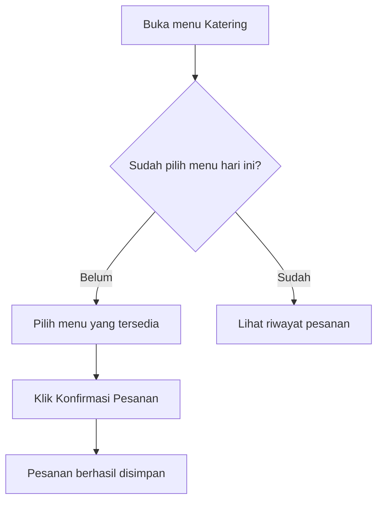

# User Guide Writer

Write the document in Bahasa Indonesia unless the user asks otherwise.

Writes documentation read by the **application's end users** (employees, admins, vendors, customers — not developers). Top priority: easy to understand for people who don't know technical terms, and usable step by step with the app open.

## Difference from Other Documentation Skills

| Skill | Audience | Language | Content |
|---|---|---|---|
| `prd-writer` | Dev/product team | Technical | Requirements, architecture, schema |
| `coding-standards` (`references/api-doc.md`) | API-consuming developers | Technical | Endpoints, payloads, status codes |
| **`user-guide`** | **App users (non-technical)** | **Simple, action-first** | **How to use features, click steps, screenshots** |

If the user asks for "dokumentasi" without specifics, ask or infer from context — if it's meant to be read by employees/admins who use the app, this is the right skill.

## Information Sources

First check whether a related PRD exists in this conversation/project (from the `prd-writer` skill or uploaded by the user) — use it as the source of truth for features, roles, and flows. If there is no PRD, ask the user which features need documenting, or ask them to explain/screenshot the flow.

## Agree on the Outline First (for large documents)

**For documents with many features/roles (roughly >5 sections)**, don't write the full draft start to finish right away — first agree on the **outline/table of contents** with the user before drafting each section:

1. List the sections to be written (per role if multi-role, per feature from the PRD) as a short outline — just section title + a 1-line summary of its content, not a full draft
2. Show this outline to the user to confirm/revise before full writing — any missing sections, unneeded sections, or order changes
3. Once the outline is approved, write the full draft section by section

**For small documents (≤5 sections, 1 role, few features)**, write the full draft directly without a separate outline stage — the confirmation overhead isn't worth it for short documents.

Reason for this stage: a badly structured user guide (missing sections, confusing order, parts irrelevant to that role) discovered only after the user reads the full draft means major rework — confirming the skeleton first is much cheaper to fix.

## Document Structure

### 1. Title & Opening
```
# Panduan Penggunaan [Nama Aplikasi]
## Untuk [Nama Role, misal: Karyawan / Admin HR]

[1-2 kalimat pembuka: aplikasi ini untuk apa, panduan ini akan membahas apa]
```

### 2. Daftar Isi
Required for documents with many features (>3 sections), so the user can jump straight to the part they need without scrolling from the top.

### 3. Memulai (Getting Started)
- How to access the app (link, how to log in, app download if mobile)
- The first screen the user will see (describe it, include a screenshot if available)

### 4. Per-Feature Guide

This is the main part — one section per main feature/capability relevant to that role. Format for each feature:

```
## [Nama Fitur dalam bahasa user, bukan istilah teknis]

[1 kalimat: fitur ini buat apa]

**Langkah-langkah:**
1. [Aksi konkret — "Klik tombol...", "Isi kolom...", "Pilih..."]
2. [Aksi berikutnya]
3. [Hasil yang akan terlihat]

[Screenshot kalau tersedia]

> 💡 **Tips:** [kalau ada catatan berguna, opsional]
> ⚠️ **Perhatian:** [kalau ada hal yang sering salah/perlu diwaspadai, opsional]
```

**Language rules:**
- Use direct active verbs: "Klik", "Pilih", "Isi" — not passive ("tombol dapat diklik")
- Avoid technical terms: not "submit form" but "klik tombol Kirim/Simpan"; not "endpoint gagal merespons" but "coba lagi beberapa saat, atau hubungi admin kalau masih gagal"
- Name buttons/menus **exactly** as written in the app (if the button says "Simpan Perubahan", don't write "klik simpan" — use the full name, consistently)
- Short sentences, one instruction per step — don't combine several actions in one point

### 5. Flow Flowchart (if there is a multi-step/conditional process)

**Include a Mermaid flowchart** for flows with branches or more than ~4 sequential steps — it helps the user see the "big picture" before the step details. Unlike the technical flowcharts in `prd-writer`, here **labels use the user's language**, not system terms:



Place the flowchart at the **start of the feature section** (before the detailed steps) as an overview, or at the end as a summary — whichever best fits the feature's complexity. For simple features (2-3 linear steps without branches), don't force a flowchart — a numbered list is enough.

### 6. Screenshots (Optional)

Screenshots are **highly recommended** but optional — include them if:
- The user uploads usable app screenshots, OR
- An artifact/mockup from the `mockup-prototype` skill was already made in this conversation, OR
- The user explicitly asks for an accompanying mockup for the documentation

**How to include:**
- If the user uploads real app images (upload location differs per environment — use the path the user/environment gives), use those images directly — copy them to the output location and reference them with markdown image syntax
- If no screenshot is available and the user didn't ask for one to be made, **do not invent images** — write a clear placeholder that's easy to fill later:
  ```
  > 📸 *[Screenshot: tampilan halaman pilih menu]*
  ```
- If the user asks for accompanying visuals but there are no real screenshots, offer to make a simple mockup via the `mockup-prototype` skill as a substitute; don't pretend it is a real app screenshot

### 7. Pertanyaan Umum (FAQ) — Optional

If there are likely questions (from edge cases in the PRD, or common points of confusion), collect them into a short FAQ:
```
**Q: Apa yang terjadi kalau saya tidak pilih menu sampai batas waktu?**
A: Sistem otomatis memesankan menu default untuk kamu, kecuali hari itu kamu sedang cuti atau libur.
```

### 8. Butuh Bantuan?
Short closing section: who/which channel to contact if the user has a problem not covered by this guide.

## Writing Principles

1. **Write for a reader who has never used this app.** If unsure whether a term needs explaining, explain it — slightly too much is better than confusing the user.
2. **Order follows the real click order**, not the developer's logical order. Follow the sequence the user actually sees on screen.
3. **Screenshots and flowcharts complement the text, not replace it.** Still write full text instructions even with visuals, because not everyone reads images carefully (and images may not render on every reading platform).
4. **Split documents per role if the app is multi-role** with very different views/capabilities (employee vs. admin) — don't merge into one mixed document that confuses employees reading admin parts, or vice versa.
5. **Update as the app changes.** If the user says a feature changed, revise only that part; don't rewrite the whole document from scratch.

## Output Format

The document is created as a **Markdown file** (`.md`) with the file-creation tool available in this environment, then presented/sent to the user with the file-display tool (tool names vary by environment) — so the user can save and share it. If the user explicitly asks for Word format (for formal distribution to employees/printing), use the built-in `docx` skill to convert after the markdown draft is approved.

## Related Skills
- `prd-writer` — source of requirements/features to base the content on
- `mockup-prototype` — source of substitute visuals/screenshots when real screenshots don't exist yet
- `docx` (built-in) — when a Word version is needed for formal distribution
