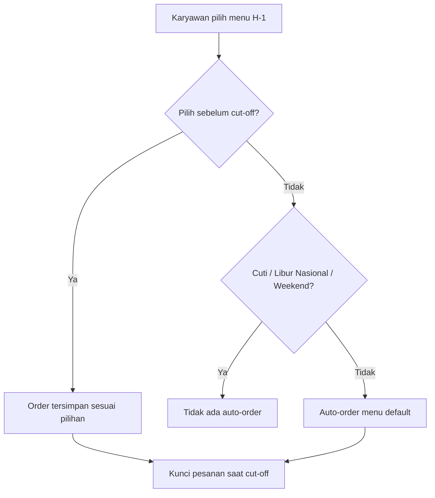
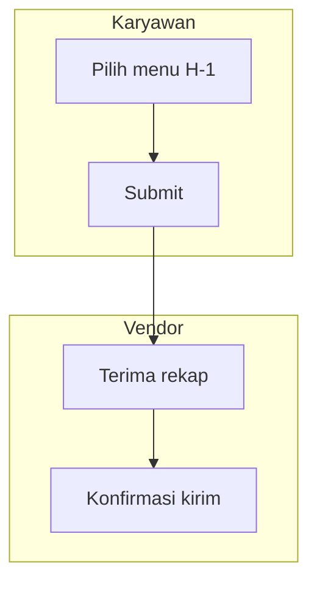

# PRD Writer

Susun PRD dengan struktur baku di bawah ini. **Setiap PRD wajib punya diagram** — minimal satu flowchart/sequence diagram untuk alur utama (User Flow atau Architecture) dan satu ERD untuk Database Schema, keduanya dalam format Mermaid supaya bisa dirender langsung di Markdown/Notion/GitHub.

Contoh acuan lengkap ada di bagian akhir skill ini (PRD SmartCatering HR) — pakai sebagai referensi pola penulisan, tingkat kedetailan, dan gaya bahasa.

## Langkah 0: Deskripsi Singkat → Pertanyaan Klarifikasi → Baru Generate PRD

**Ini alur wajib, bukan opsional.** Jangan langsung menulis PRD lengkap dari deskripsi singkat di awal — meskipun deskripsinya terlihat cukup jelas. Selalu lewat tahap tanya-jawab dulu sebelum drafting.

**Alur:**

1. User kasih deskripsi singkat (contoh: "bikinin PRD buat sistem approval cuti" atau beberapa kalimat tentang sistem yang mau dibuat).

2. **Analisis deskripsi itu, lalu susun pertanyaan klarifikasi yang disesuaikan dengan konteksnya** — **minimal 5 pertanyaan**, jumlah di atas itu bervariasi tergantung kompleksitas (sistem sederhana cukup di kisaran 5, sistem yang menyinggung integrasi, aturan finansial, atau multi-role bisa 6-8 atau lebih). Kalau deskripsi user sudah cukup detail sehingga sebagian area sudah terjawab, tetap cari minimal 5 titik yang perlu diklarifikasi/dikonfirmasi — turunkan ke detail yang lebih spesifik (bukan mengulang hal yang sudah jelas dari deskripsi) daripada mengurangi jumlah pertanyaan. Pertanyaan digali dari apa yang **belum disebutkan** di deskripsi tapi dibutuhkan untuk menyusun PRD lengkap, arahnya seputar:
   - Role/pengguna dan perbedaan akses tiap role
   - Sistem berdiri sendiri atau terintegrasi ke sistem lain (kalau iya: sistem apa, lewat cara apa, siapa yang mengelola)
   - Aturan bisnis/kalkulasi/logic otomatisasi spesifik yang jadi inti sistem
   - Batasan teknis yang sudah pasti (stack wajib, database existing, constraint infra)
   - Notifikasi/alert yang dibutuhkan (kapan, ke siapa, lewat channel apa)
   - Skala/volume pemakaian yang diperkirakan (relevan untuk keputusan arsitektur — sistem internal skala kecil vs yang perlu dipikirkan performa sejak awal)
   - Hal spesifik yang tersirat dari deskripsi tapi perlu dikonfirmasi (misal deskripsi bilang "approval cuti" — perlu tahu berapa level approval, siapa approver, ada eskalasi atau tidak)

   Jangan pakai daftar pertanyaan template yang sama persis di semua PRD — pertanyaannya harus terasa seperti benar-benar merespons deskripsi yang diberikan, bukan checklist generik.

3. **Presentasikan semua pertanyaan sekaligus** dalam satu balasan, sebelum drafting apa pun:
   - Pertanyaan yang jawabannya jelas berupa pilihan diskrit (misal "berdiri sendiri atau terintegrasi?") → kalau environment ini punya tool tanya-jawab interaktif (pilihan tap/klik), pakai itu
   - Pertanyaan yang butuh jawaban naratif/bebas (misal "jelaskan aturan approval-nya") → tulis sebagai daftar bernomor dalam prosa di pesan yang sama
   - Kalau jumlah pertanyaan pilihan lebih dari kapasitas satu kali panggil tool tanya-jawab tersebut, pilih yang paling penting untuk lewat tool itu, sisanya gabung ke daftar pertanyaan prosa. Kalau tool semacam itu tidak tersedia di environment ini, semua pertanyaan cukup ditulis sebagai daftar bernomor dalam prosa
   - Boleh dikelompokkan per topik (misal "Soal Role & Akses", "Soal Integrasi", "Soal Aturan Bisnis") kalau jumlahnya banyak, supaya user tidak menghadapi wall of text tak terstruktur

4. **Tunggu jawaban user.** Jangan mulai drafting PRD di respons yang sama dengan pertanyaan.

5. Setelah dijawab, **susun draft PRD lengkap sekaligus** — jangan pecah lagi jadi konfirmasi per section. Kalau jawaban user masih menyisakan detail kecil yang belum tercakup (bukan hal besar yang menentukan struktur PRD), isi dengan asumsi wajar dan tandai eksplisit di draft (misal catatan `[asumsi: ...]`) untuk direview, tidak perlu putaran tanya-jawab lagi.

**Pengecualian:** kalau user secara eksplisit minta "langsung buat PRD-nya tanpa tanya-tanya" atau semacamnya, ikuti permintaan itu dan drafting langsung dengan asumsi yang ditandai jelas di draft — jangan paksakan tahap pertanyaan kalau user sudah bilang tidak perlu.

## Mode Alternatif: Reverse-PRD (dari Kode Existing yang Belum Terdokumentasi)

Kalau user minta **"buatkan PRD dari project/kode yang sudah ada"** (bukan sistem baru) — situasi umum di kerjaan freelance/legacy project yang tidak pernah ada dokumen requirement-nya — alurnya terbalik dari biasanya: gali requirement **dari kode**, bukan dari brief user.

**Langkah:**
1. **Eksplorasi codebase dulu** sebelum menulis apa pun — baca struktur folder, model/entity database, endpoint yang ada, dan komponen frontend utama. Tujuannya memahami apa yang sistem **benar-benar lakukan**, bukan menebak dari nama file saja.
2. **Susun ulang tiap section PRD dari bukti di kode:**
   - Core Features — dari endpoint dan komponen UI yang ada, kelompokkan jadi fitur (bukan daftar teknis "controller X, komponen Y")
   - Database Schema — generate ERD dari migration/schema aktual, bukan ditulis ulang manual (kalau ada akses langsung ke database, lebih akurat lagi dibanding cuma baca file migration yang mungkin sudah tidak sinkron)
   - API Design — dari route yang benar-benar terdaftar di router, bukan asumsi
   - Requirements/RBAC — dari middleware/guard yang ada di kode (role apa yang di-cek di mana) — **ini bagian paling rawan salah** kalau cuma ditebak, karena aturan akses sering tersebar dan implisit di kode lama
3. **Tandai eksplisit bagian yang tidak bisa dipastikan dari kode** — kalau ada logic yang ambigu (kenapa kondisi ini ada, apa yang terjadi kalau kasus X), jangan mengarang penjelasan bisnisnya. Tulis sebagai catatan terbuka ("Tidak jelas dari kode: alasan bisnis di balik kondisi ini — perlu konfirmasi user") alih-alih diam-diam mengisi dengan tebakan yang terdengar meyakinkan.
4. User Flow dan Architecture tetap butuh diagram (flowchart/sequence) seperti biasa, disusun dari alur yang benar-benar terjadi di kode (trace request dari route sampai response), bukan alur ideal yang seharusnya.
5. Setelah draft jadi, **user perlu mereview lebih ketat dibanding PRD sistem baru** — karena PRD ini merepresentasikan sistem yang sudah berjalan, kesalahan interpretasi kode bisa terbawa jadi "dokumentasi resmi" yang salah. Ingatkan user untuk cross-check terutama bagian yang ditandai di poin 3.

Reverse-PRD berguna untuk: onboarding developer baru ke project lama, dasar sebelum melakukan refactor besar (dokumentasikan dulu apa yang ada sebelum diubah), atau syarat client yang minta dokumentasi retroaktif untuk project yang sudah jalan.

## Struktur Wajib

### 1. Header
```
# PRD — [Nama Sistem/Fitur]

**Version:** [semver, mulai dari 1.0 atau 1.x kalau masih draft berkembang]
**Tanggal:** [tanggal penulisan]
**Status:** Draft / Review / Approved
**Sistem:** [standalone / bagian dari sistem X, terintegrasi ke Y via Z]
**Acuan kode:** `wahid-toolkit:coding-standards` (sebutkan kalau relevan)
```

### 2. Overview
- Definisikan sistem dalam 1 paragraf: apa itu, siapa yang punya/mengelola, bagaimana relasinya dengan sistem lain (standalone/terintegrasi)
- **Masalah yang diselesaikan** — paragraf terpisah, spesifik dan konkret (bukan generik "meningkatkan efisiensi"). Sebutkan angka/dampak kalau ada data pendukung
- **Tujuan sistem** — paragraf terpisah, turunan langsung dari masalah di atas, bukan daftar fitur

### 3. Requirements
Kelompokkan per kategori, format bullet bertingkat:
- **Aksesibilitas Pengguna** — platform apa saja yang dipakai (web/mobile/kiosk), siapa pakai yang mana
- **Peran & Hak Akses (RBAC)** — setiap role dijelaskan: cara akses (login sendiri vs lewat sistem lain), apa yang BISA dilakukan, dan **eksplisit apa yang TIDAK BISA dilakukan** (read-only, tidak bisa ubah X). Ambiguitas siapa boleh apa adalah sumber bug paling umum — jangan biarkan longgar
- **Metode Input & Validasi** — cara data masuk ke sistem (form, scan, import, dll)
- **Logika Otomatisasi** (kalau ada) — jelaskan aturan dan **pengecualiannya** secara eksplisit, termasuk kasus edge (libur, cuti, weekend, dll) dan apakah pengecualian ini absolut atau ada override manual
- **Sistem Notifikasi & Alert** — kapan, ke siapa, lewat channel apa
- **Aturan Finansial/Bisnis Spesifik** (kalau ada) — kalkulasi, subsidi, pemotongan, dll dengan aturan yang tidak ambigu

### 4. Core Features
Numbered list per modul/kelompok fitur besar, tiap modul punya sub-bullet fitur detail dengan **bold** nama fitur di depan:
```
1. **[Nama Modul]**
   * **[Nama Fitur]:** [deskripsi 1-2 kalimat, jelas apa yang terjadi]
   * **[Nama Fitur]:** [deskripsi]
```
Tulis fitur sebagai kapabilitas konkret ("Konfigurasi Jam Cut-Off (GA)"), bukan judul vague ("Manajemen Waktu").

### 5. User Flow
Numbered list step-by-step, actor jelas di tiap langkah, termasuk **percabangan kondisional** (kalau X maka Y, kalau tidak maka Z) ditulis eksplisit dalam prosa. Flow harus bisa diikuti dari awal sampai akhir tanpa lompat asumsi.

**WAJIB: Flowchart (Mermaid)** mendampingi prosa di atas — terutama kalau ada percabangan kondisional (if/else, beberapa kemungkinan status, keputusan otomatis vs manual). Prosa menjelaskan detail tiap langkah, flowchart memvisualisasikan percabangannya supaya bisa dipindai cepat tanpa membaca semua teks:



Gunakan `flowchart TD` (top-down) untuk alur linear dengan sedikit percabangan, atau `flowchart LR` (left-right) kalau lebih cocok mendatar (misal tahapan proses lintas beberapa sistem). Node keputusan pakai bentuk `{...}`, node aksi/hasil pakai `[...]`. Setiap panah dari node keputusan wajib diberi label kondisinya (`-->|Ya|`, `-->|Tidak|`, atau label kondisi spesifik seperti `-->|Status: Cuti|`).

Kalau User Flow melibatkan lebih dari satu role dengan jalur terpisah (misal Karyawan vs Admin HR vs Vendor), pertimbangkan flowchart terpisah per role, atau satu flowchart besar dengan subgraph per role:


### 6. Architecture

Ini bagian paling teknis — wajib menjelaskan:
- **Keputusan stack dan alasannya** — jangan cuma sebut teknologi, jelaskan *rasional* memilihnya (reuse existing stack, tim yang sama merawat, dst). Kalau ada keputusan yang menyimpang dari default/preferensi umum, jelaskan trade-off yang dipertimbangkan
- **Pola integrasi** kalau sistem ini terhubung ke sistem lain — siapa manggil siapa, lewat proxy atau direct, kenapa
- **Struktur folder/layer backend** — konkret, sesuai stack yang dipilih (rujuk `coding-standards` bagian struktur folder & ORM sesuai stack)
- **Konvensi ORM & response format** — tegaskan sumber kebenaran konvensi (ikut existing codebase kalau terintegrasi ke sistem lama, atau `coding-standards` default kalau sistem baru murni)
- **Frontend layering** — state management, service layer (rujuk `coding-standards` bagian frontend)
- **WAJIB: Sequence diagram (Mermaid)** untuk alur utama end-to-end (minimal 1, lebih untuk sistem kompleks), termasuk semua actor/service yang terlibat:
  ```mermaid
  sequenceDiagram
      autonumber
      actor User
      participant Client
      participant Backend
      participant DB

      User->>Client: Aksi
      Client->>Backend: Request
      Backend->>DB: Query
      DB-->>Backend: Result
      Backend-->>Client: Response
  ```

### 7. Database Schema

- Sebutkan konvensi naming yang diikuti (rujuk `coding-standards` bagian database)
- **WAJIB: ERD (Mermaid)** untuk seluruh tabel dan relasinya:
  ```mermaid
  erDiagram
      USERS ||--o{ ORDERS : places
      USERS {
          uuid id PK
          string name
          timestamp created_at
      }
      ORDERS {
          uuid id PK
          uuid user_id FK
          timestamp created_at
      }
  ```
- **Tabel rincian** setelah ERD — satu baris per tabel, kolom: Nama Tabel | Kolom Utama | Tipe Data | Keterangan. Keterangan wajib jelaskan hal yang **tidak terlihat dari nama kolom saja**: aturan bisnis, kolom mana yang tidak boleh ditimpa job tertentu, kenapa suatu data di-cache/duplikasi, dll — bukan sekadar mengulang nama kolom dalam kalimat.

### 8. API Design

- Sebutkan prinsip yang diikuti (rujuk `coding-standards` bagian API — versioning, response format, query filter) dan tegaskan **bentuk konkret response** yang dipakai (envelope generik vs pola existing project — pilih sesuai konteks, jangan asal ikut default kalau project sudah punya pola sendiri)
- List endpoint per grup, method + path + query param penting, dengan catatan role/auth yang berlaku kalau relevan
- Kalau ada endpoint dengan aturan keamanan/privasi khusus (mis. anonimisasi data), sebutkan eksplisit di tingkat DTO/response — bukan cuma prosa umum

### 9. Design & Technical Constraints

- **High-Level Technology** — breakdown per layer (frontend/backend/ORM/database/deployment) dengan **rasional** tiap pilihan, bukan cuma daftar nama teknologi
- **Konvensi Kode** — tegaskan bagian mana dari standar (`coding-standards` atau skill lain) yang **berlaku penuh** dan bagian mana yang **tidak relevan** untuk stack di PRD ini (misal: bagian ORM Prisma tidak relevan kalau sistemnya pakai Golang) — supaya orang yang baca tidak salah terap standar Node.js ke project Golang
- Baris terakhir: "Deviasi dari standar ini wajib didokumentasikan alasannya di komentar kode."

## Prinsip Penulisan

1. **Spesifik, bukan generik.** Setiap requirement harus bisa diverifikasi — hindari kata seperti "user-friendly", "efisien", "modern" tanpa penjelasan konkret apa artinya secara teknis.
2. **Eksplisit soal edge case.** Kalau ada aturan, sebutkan pengecualiannya. Kalau ada role, sebutkan batasannya. Ambiguitas di PRD jadi bug atau debat di tengah development.
3. **Jelaskan alasan (rasional), bukan cuma keputusan.** "Pakai Golang" kurang berguna dibanding "Pakai Golang karena selaras dengan backend absensi yang sudah ada, tim yang sama, hindari maintain dua stack."
4. **Rujuk standar existing, jangan duplikasi.** Kalau ada `coding-standards` atau konvensi project lain yang relevan, kutip section-nya (`bagian 6.2 coding-standards`) alih-alih menuliskan ulang seluruh aturannya di PRD.
5. **Diagram bukan pelengkap, tapi bagian dari spesifikasi.** Flowchart (User Flow), sequence diagram (Architecture), dan ERD (Database Schema) harus akurat mencerminkan isi prosa di atasnya — bukan ilustrasi generik.

## Format Output

PRD selalu dibuat sebagai **file Markdown** (bukan jawaban inline di chat) karena ini dokumen yang akan disimpan, di-share, dan jadi acuan development. Buat file-nya lewat tool pembuat file yang tersedia di environment ini, lalu sajikan/kirimkan ke user lewat tool untuk menampilkan file (nama tool bervariasi tergantung environment — Claude.ai, Claude Code, atau lainnya — sesuaikan dengan yang tersedia saat itu).

---

## Contoh Acuan Lengkap

Contoh di bawah (PRD SmartCatering HR, v1.4) menunjukkan tingkat kedetailan dan gaya penulisan yang diharapkan — perhatikan bagaimana requirement ditulis eksplisit dengan pengecualian, bagaimana rasional keputusan arsitektur dijelaskan, dan bagaimana sequence diagram + ERD melengkapi (bukan mengulang) prosa:

> Overview membuka dengan definisi sistem + kepemilikan + pola integrasi dalam satu paragraf, diikuti paragraf masalah yang konkret (bukan "pemesanan tidak efisien" tapi "tingginya potensi pemborosan anggaran katering akibat ketidaksesuaian jumlah porsi dengan kehadiran aktual").
>
> Requirements RBAC menulis tiap role dengan pola: cara akses → yang BISA dilakukan → yang TIDAK BISA dilakukan secara eksplisit (mis. "Admin HR ... read-only — tidak mengatur subsidi/vendor/menu").
>
> Logika Otomatisasi menulis aturan DAN pengecualiannya secara presisi: "kecuali tanggal tersebut hari libur nasional, karyawan berstatus cuti, atau akhir pekan ... Karyawan tetap boleh memesan manual di luar hari kerja tersebut kalau mereka mau — pengecualian ini hanya berlaku untuk auto-order, bukan pembatasan pemesanan manual."
>
> Architecture menjelaskan rasional stack ("Golang + Gin, selaras dengan stack backend absensi ... supaya tim yang sama tidak perlu belajar/maintain dua stack backend berbeda"), pola integrasi (proxy vs direct, dengan alasan JWT/CORS), dan diagram sequence lengkap dengan semua service yang terlibat (client → proxy → backend → database → sistem eksternal).
>
> Database Schema menyertakan ERD Mermaid lengkap plus tabel rincian yang kolom "Keterangan"-nya menjelaskan aturan bisnis tersembunyi (mis. "`subsidy_amount` diatur manual oleh GA per karyawan dan tidak boleh ditimpa oleh job sync identitas — job sync hanya update `name`/`rfid_tag`").
>
> Design & Technical Constraints menutup dengan penegasan bagian standar mana yang berlaku dan mana yang tidak relevan untuk stack yang dipilih di PRD ini — supaya tidak ada kebingungan menerapkan standar yang salah stack.

Gunakan pola-pola ini sebagai kalibrasi kualitas, sesuaikan struktur detail dengan kompleksitas sistem yang sedang di-PRD-kan (sistem kecil tidak perlu semua sub-section dipaksakan ada).
