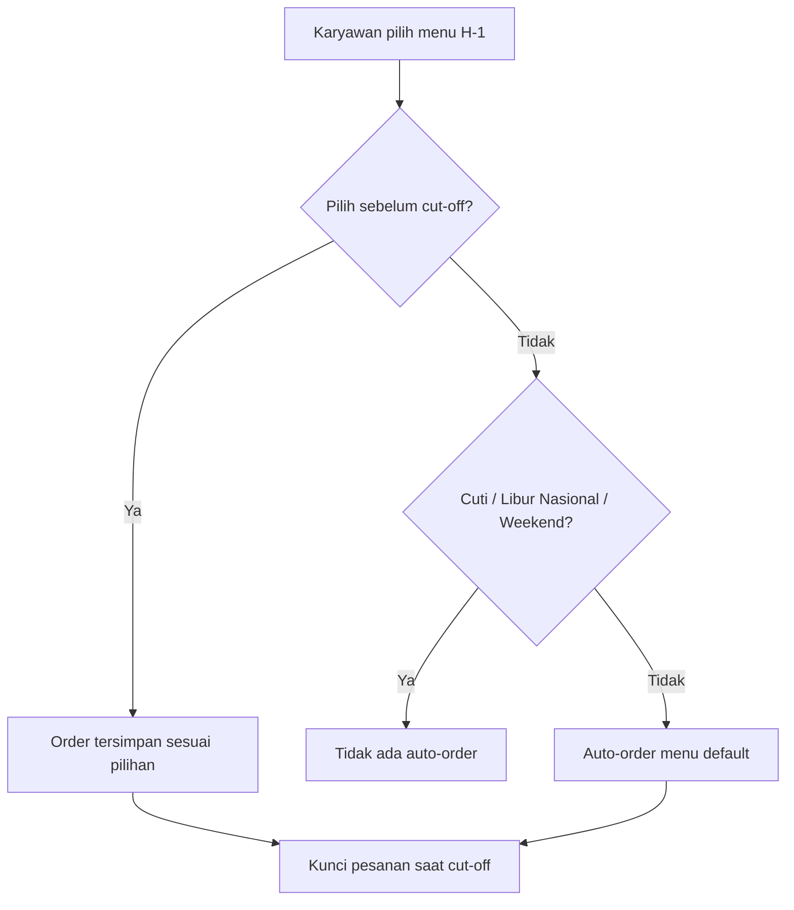
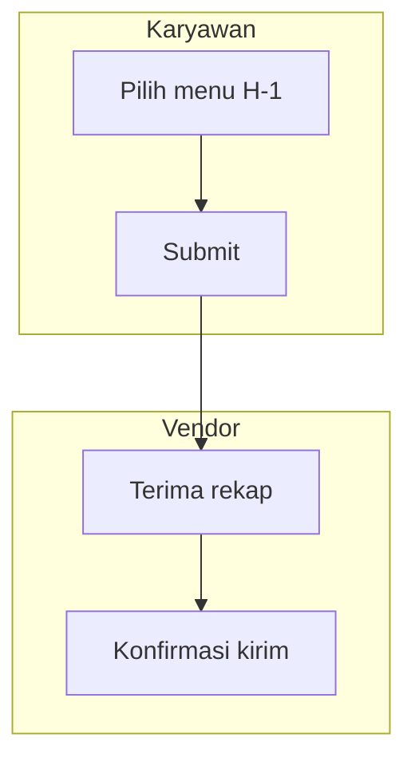

# PRD Writer

Write the document in Bahasa Indonesia unless the user asks otherwise.

Write the PRD using the standard structure below. **Every PRD must have diagrams** — at least one flowchart/sequence diagram for the main flow (User Flow or Architecture) and one ERD for the Database Schema, both in Mermaid so they render directly in Markdown/Notion/GitHub.

A full reference example is at the end of this skill (PRD Kantin Karyawan) — use it as the reference for writing patterns, level of detail, and language style.

## Step 0: Short Description → Clarifying Questions → Then Generate the PRD

**This flow is mandatory, not optional.** Do not write the full PRD straight from the initial short description — even if it looks clear enough. Always go through a Q&A stage before drafting.

**Flow:**

1. The user gives a short description (e.g. "bikinin PRD buat sistem approval cuti" or a few sentences about the system they want to build).

2. **Analyze that description, then write clarifying questions tailored to its context** — **at least 5 questions**; beyond that the number varies with complexity (a simple system needs around 5; a system touching integrations, financial rules, or multiple roles may need 6-8 or more). If the description is already detailed enough that some areas are answered, still find at least 5 points to clarify/confirm — drill into more specific details (not repeating what the description already makes clear) rather than asking fewer questions. Draw questions from what is **not yet mentioned** in the description but is needed for a complete PRD, around:
   - Roles/users and how access differs per role
   - Standalone or integrated with other systems (if integrated: which system, how, who manages it)
   - Specific business rules/calculations/automation logic at the core of the system
   - Fixed technical constraints (mandatory stack, existing database, infra constraints)
   - Required notifications/alerts (when, to whom, via which channel)
   - Expected usage scale/volume (relevant to architecture decisions — small internal system vs. one that needs performance thinking from the start)
   - Specific things implied by the description that need confirming (e.g. the description says "approval cuti" — need to know how many approval levels, who approves, whether there is escalation)

   Do not use the exact same template question list for every PRD — the questions must feel like they genuinely respond to the given description, not a generic checklist.

3. **Present all questions at once** in a single reply, before any drafting:
   - Questions whose answer is clearly a discrete choice (e.g. "berdiri sendiri atau terintegrasi?") → if this environment has an interactive question tool (tap/click choices), use it
   - Questions needing a narrative/free answer (e.g. "jelaskan aturan approval-nya") → write them as a numbered prose list in the same message
   - If there are more choice questions than that tool can take in one call, send the most important ones through the tool and merge the rest into the prose list. If no such tool exists in this environment, write all questions as a numbered prose list
   - You may group them by topic (e.g. "Soal Role & Akses", "Soal Integrasi", "Soal Aturan Bisnis") when there are many, so the user isn't faced with an unstructured wall of text

4. **Wait for the user's answers.** Do not start drafting the PRD in the same response as the questions.

5. Once answered, **write the full PRD draft in one go** — do not split it again into per-section confirmations. If the answers still leave small details uncovered (not big things that determine the PRD structure), fill them with reasonable assumptions and mark them explicitly in the draft (e.g. a `[asumsi: ...]` note) for review; no further Q&A round needed.

**Exception:** if the user explicitly asks "langsung buat PRD-nya tanpa tanya-tanya" or similar, follow that and draft directly with assumptions clearly marked in the draft — do not force the question stage when the user said it isn't needed.

## Alternative Mode: Reverse-PRD (from Existing Undocumented Code)

If the user asks **"buatkan PRD dari project/kode yang sudah ada"** (not a new system) — common in freelance/legacy projects that never had a requirements document — the flow is reversed: derive requirements **from the code**, not from the user's brief.

**Steps:**
1. **Explore the codebase first** before writing anything — read the folder structure, database models/entities, existing endpoints, and main frontend components. The goal is to understand what the system **actually does**, not guess from file names.
2. **Rebuild each PRD section from evidence in the code:**
   - Core Features — from existing endpoints and UI components, grouped into features (not a technical list of "controller X, component Y")
   - Database Schema — generate the ERD from the actual migrations/schema, not rewritten by hand (direct database access is even more accurate than reading migration files that may be out of sync)
   - API Design — from routes actually registered in the router, not assumptions
   - Requirements/RBAC — from middleware/guards in the code (which role is checked where) — **this is the most error-prone part** if guessed, because access rules are often scattered and implicit in old code
3. **Explicitly mark parts that cannot be confirmed from the code** — if some logic is ambiguous (why this condition exists, what happens in case X), do not invent its business explanation. Write it as an open note ("Tidak jelas dari kode: alasan bisnis di balik kondisi ini — perlu konfirmasi user") instead of quietly filling it with a convincing-sounding guess.
4. User Flow and Architecture still need diagrams (flowchart/sequence) as usual, built from the flow that actually happens in the code (trace a request from route to response), not the ideal flow it should have.
5. Once drafted, **the user must review more strictly than a new-system PRD** — because this PRD represents a running system, code misinterpretations can become wrong "official documentation". Remind the user to cross-check, especially the parts marked in point 3.

Reverse-PRD is useful for: onboarding new developers to an old project, a baseline before a major refactor (document what exists before changing it), or a client requirement for retroactive documentation of a running project.

## Required Structure

### 1. Header
```
# PRD — [Nama Sistem/Fitur]

**Version:** [semver, mulai dari 1.0 atau 1.x kalau masih draft berkembang]
**Tanggal:** [tanggal penulisan]
**Status:** Draft / Review / Approved
**Sistem:** [standalone / bagian dari sistem X, terintegrasi ke Y via Z]
**Acuan kode:** `noskill:coding-standards` (sebutkan kalau relevan)
```

### 2. Overview
- Define the system in 1 paragraph: what it is, who owns/manages it, how it relates to other systems (standalone/integrated)
- **Masalah yang diselesaikan** — separate paragraph, specific and concrete (not a generic "meningkatkan efisiensi"). Cite numbers/impact if supporting data exists
- **Tujuan sistem** — separate paragraph, derived directly from the problem above, not a feature list

### 3. Requirements
Group by category, nested bullet format:
- **Aksesibilitas Pengguna** — which platforms are used (web/mobile/kiosk), who uses which
- **Peran & Hak Akses (RBAC)** — for each role: how it accesses (own login vs. via another system), what it CAN do, and **explicitly what it CANNOT do** (read-only, cannot change X). Ambiguity about who may do what is the most common source of bugs — do not leave it loose
- **Metode Input & Validasi** — how data enters the system (form, scan, import, etc.)
- **Logika Otomatisasi** (if any) — state the rules and **their exceptions** explicitly, including edge cases (holidays, leave, weekends, etc.) and whether these exceptions are absolute or allow manual override
- **Sistem Notifikasi & Alert** — when, to whom, via which channel
- **Aturan Finansial/Bisnis Spesifik** (if any) — calculations, subsidies, deductions, etc. with unambiguous rules

### 4. Core Features
Numbered list per module/major feature group; each module has detailed feature sub-bullets with the feature name in **bold** first:
```
1. **[Nama Modul]**
   * **[Nama Fitur]:** [deskripsi 1-2 kalimat, jelas apa yang terjadi]
   * **[Nama Fitur]:** [deskripsi]
```
Write features as concrete capabilities ("Konfigurasi Jam Cut-Off (GA)"), not vague titles ("Manajemen Waktu").

### 5. User Flow
Numbered step-by-step list, with a clear actor at each step, including **conditional branches** (if X then Y, otherwise Z) written explicitly in prose. The flow must be followable from start to end without assumption leaps.

**REQUIRED: Flowchart (Mermaid)** alongside the prose above — especially when there are conditional branches (if/else, several possible statuses, automatic vs. manual decisions). The prose explains each step in detail; the flowchart visualizes the branches so they can be scanned quickly without reading all the text:



Use `flowchart TD` (top-down) for linear flows with few branches, or `flowchart LR` (left-right) when horizontal fits better (e.g. process stages across several systems). Decision nodes use `{...}`, action/result nodes use `[...]`. Every arrow from a decision node must be labeled with its condition (`-->|Ya|`, `-->|Tidak|`, or a specific condition label like `-->|Status: Cuti|`).

If the User Flow involves more than one role with separate paths (e.g. Karyawan vs Admin HR vs Vendor), consider separate flowcharts per role, or one large flowchart with a subgraph per role:


### 6. Architecture

This is the most technical section — it must explain:
- **Stack decisions and their reasons** — don't just name technologies, explain the *rationale* for choosing them (reuse existing stack, same team maintains it, etc.). If a decision deviates from the usual default/preference, explain the trade-offs considered
- **Integration pattern** if the system connects to other systems — who calls whom, via proxy or direct, and why
- **Backend folder/layer structure** — concrete, matching the chosen stack (refer to the `coding-standards` folder structure & ORM sections for that stack)
- **ORM & response format conventions** — state the source of truth for conventions (follow the existing codebase if integrating into an old system, or the `coding-standards` default for a purely new system)
- **Frontend layering** — state management, service layer (refer to the `coding-standards` frontend section)
- **REQUIRED: Sequence diagram (Mermaid)** for the main end-to-end flow (at least 1, more for complex systems), including all actors/services involved:
  ```mermaid
  sequenceDiagram
      autonumber
      actor User
      participant Client
      participant Backend
      participant DB

      User->>Client: Aksi
      Client->>Backend: Request
      Backend->>DB: Query
      DB-->>Backend: Result
      Backend-->>Client: Response
  ```

### 7. Database Schema

- State the naming convention followed (refer to the `coding-standards` database section)
- **REQUIRED: ERD (Mermaid)** for all tables and their relations:
  ```mermaid
  erDiagram
      USERS ||--o{ ORDERS : places
      USERS {
          uuid id PK
          string name
          timestamp created_at
      }
      ORDERS {
          uuid id PK
          uuid user_id FK
          timestamp created_at
      }
  ```
- **Detail table** after the ERD — one row per table, columns: Nama Tabel | Kolom Utama | Tipe Data | Keterangan. Keterangan must explain what is **not visible from the column name alone**: business rules, which columns a given job must not overwrite, why some data is cached/duplicated, etc. — not just restating the column name in a sentence.

### 8. API Design

- State the principles followed (refer to the `coding-standards` API section — versioning, response format, query filters) and state the **concrete response shape** used (generic envelope vs. the existing project's pattern — choose by context; don't blindly follow the default if the project already has its own pattern)
- List endpoints per group, method + path + important query params, with applicable role/auth notes where relevant
- If an endpoint has special security/privacy rules (e.g. data anonymization), state them explicitly at the DTO/response level — not just general prose

### 9. Design & Technical Constraints

- **High-Level Technology** — breakdown per layer (frontend/backend/ORM/database/deployment) with the **rationale** for each choice, not just a list of technology names
- **Konvensi Kode** — state which parts of the standards (`coding-standards` or other skills) **apply fully** and which are **not relevant** to this PRD's stack (e.g. the Prisma ORM section is not relevant if the system uses Golang) — so readers don't wrongly apply Node.js standards to a Golang project
- Last line: "Deviasi dari standar ini wajib didokumentasikan alasannya di komentar kode."

## Writing Principles

1. **Specific, not generic.** Every requirement must be verifiable — avoid words like "user-friendly", "efisien", "modern" without a concrete explanation of what they mean technically.
2. **Explicit about edge cases.** If there is a rule, state its exceptions. If there is a role, state its limits. Ambiguity in a PRD becomes bugs or debates mid-development.
3. **Explain the rationale, not just the decision.** "Pakai Golang" is less useful than "Pakai Golang karena selaras dengan backend HRIS yang sudah ada, tim yang sama, hindari maintain dua stack."
4. **Refer to existing standards, don't duplicate.** If `coding-standards` or other relevant project conventions exist, cite the section (`bagian 6.2 coding-standards`) instead of rewriting all its rules in the PRD.
5. **Diagrams are not decoration but part of the spec.** The flowchart (User Flow), sequence diagram (Architecture), and ERD (Database Schema) must accurately reflect the prose above them — not generic illustrations.

## Output Format

The PRD is always created as a **Markdown file** (not an inline chat answer) because it is a document that will be saved, shared, and used as the development reference. Create the file with the file-creation tool available in this environment, then present/send it to the user with the file-display tool (tool names vary by environment — Claude.ai, Claude Code, or others — use whatever is available).

---

## Full Reference Example

The example below (PRD Kantin Karyawan) shows the expected level of detail and writing style — note how requirements are written explicitly with exceptions, how architecture decision rationale is explained, and how the sequence diagram + ERD complement (not repeat) the prose:

> Overview opens with the system definition + ownership + integration pattern in one paragraph, followed by a concrete problem paragraph (not "pemesanan tidak efisien" but "tingginya potensi pemborosan anggaran katering akibat ketidaksesuaian jumlah porsi dengan kehadiran aktual").
>
> Requirements RBAC writes each role with the pattern: access method → what it CAN do → what it CANNOT do, explicitly (e.g. "Admin HR ... read-only — tidak mengatur subsidi/vendor/menu").
>
> Logika Otomatisasi writes the rule AND its exceptions precisely: "kecuali tanggal tersebut hari libur nasional, karyawan berstatus cuti, atau akhir pekan ... Karyawan tetap boleh memesan manual di luar hari kerja tersebut kalau mereka mau — pengecualian ini hanya berlaku untuk auto-order, bukan pembatasan pemesanan manual."
>
> Architecture explains the stack rationale ("Golang + Gin, selaras dengan stack backend HRIS ... supaya tim yang sama tidak perlu belajar/maintain dua stack backend berbeda"), the integration pattern (proxy vs direct, with JWT/CORS reasons), and a full sequence diagram with all services involved (client → proxy → backend → database → external system).
>
> Database Schema includes a full Mermaid ERD plus a detail table whose "Keterangan" column explains hidden business rules (e.g. "`subsidy_amount` diatur manual oleh GA per karyawan dan tidak boleh ditimpa oleh job sync identitas — job sync hanya update `name`/`rfid_tag`").
>
> Design & Technical Constraints closes by stating which parts of the standards apply and which are irrelevant to the stack chosen in this PRD — so there is no confusion applying the wrong stack's standards.

Use these patterns as quality calibration; adapt the detailed structure to the complexity of the system being PRD'd (a small system doesn't need every sub-section forced in).
