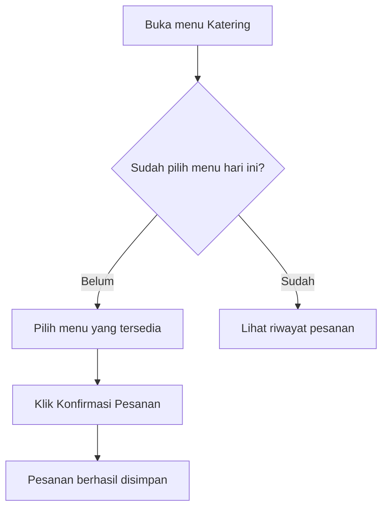

# User Guide Writer

Menyusun dokumentasi yang dibaca oleh **pengguna akhir aplikasi** (karyawan, admin, vendor, customer — bukan developer). Prioritas utama: mudah dimengerti oleh orang yang tidak paham istilah teknis, bisa langsung dipraktikkan sambil buka aplikasi.

## Perbedaan dengan Skill Dokumentasi Lain

| Skill | Audiens | Bahasa | Isi |
|---|---|---|---|
| `prd-writer` | Tim dev/product | Teknis | Requirement, arsitektur, schema |
| `coding-standards` (`references/api-doc.md`) | Developer konsumen API | Teknis | Endpoint, payload, status code |
| **`user-guide`** | **Pengguna aplikasi (non-teknis)** | **Sederhana, langsung ke tindakan** | **Cara pakai fitur, langkah klik, screenshot** |

Kalau user minta "dokumentasi" tanpa spesifik, tanyakan atau simpulkan dari konteks — kalau yang dibutuhkan buat dibaca karyawan/admin yang pakai aplikasinya, ini skill yang tepat.

## Sumber Informasi

Cek dulu apakah ada PRD terkait di percakapan/project ini (hasil skill `prd-writer` atau yang di-upload user) — pakai itu sebagai sumber kebenaran fitur, role, dan flow. Kalau tidak ada PRD, tanyakan ke user fitur apa saja yang perlu didokumentasikan, atau minta mereka jelaskan/screenshot alurnya.

## Sepakati Outline Dulu (untuk dokumen besar)

**Untuk dokumen dengan banyak fitur/role (perkiraan >5 section)**, jangan langsung tulis draft penuh dari awal sampai akhir — sepakati dulu **outline/daftar isi** dengan user sebelum drafting per section:

1. Susun daftar section yang akan ditulis (per role kalau multi-role, per fitur dari PRD) sebagai outline singkat — cukup judul section + 1 baris ringkasan isinya, bukan draft lengkap
2. Tampilkan outline ini ke user untuk dikonfirmasi/direvisi sebelum lanjut ke penulisan penuh — apakah ada section yang kurang, section yang tidak perlu, atau urutan yang perlu diubah
3. Setelah outline disetujui, baru tulis draft lengkap per section

**Untuk dokumen kecil (≤5 section, 1 role, fitur sedikit)**, langsung tulis draft penuh tanpa tahap outline terpisah — overhead konfirmasi tidak sepadan untuk dokumen singkat.

Alasan tahapan ini: dokumen user guide yang salah struktur (section kurang, urutan membingungkan, ada bagian tidak relevan untuk role tersebut) baru ketahuan setelah user baca draft penuh berarti kerja ulang besar — mengonfirmasi kerangka dulu jauh lebih murah diperbaiki.

## Struktur Dokumen

### 1. Judul & Pembuka
```
# Panduan Penggunaan [Nama Aplikasi]
## Untuk [Nama Role, misal: Karyawan / Admin HR]

[1-2 kalimat pembuka: aplikasi ini untuk apa, panduan ini akan membahas apa]
```

### 2. Daftar Isi
Wajib untuk dokumen dengan banyak fitur (>3 section), supaya user bisa lompat langsung ke bagian yang dicari tanpa scroll dari awal.

### 3. Memulai (Getting Started)
- Cara mengakses aplikasi (link, cara login, download app kalau mobile)
- Tampilan awal yang akan dilihat user pertama kali (deskripsikan, sertakan screenshot kalau ada)

### 4. Panduan Per Fitur

Ini bagian utama — satu section per fitur/kemampuan utama yang relevan untuk role tersebut. Format tiap fitur:

```
## [Nama Fitur dalam bahasa user, bukan istilah teknis]

[1 kalimat: fitur ini buat apa]

**Langkah-langkah:**
1. [Aksi konkret — "Klik tombol...", "Isi kolom...", "Pilih..."]
2. [Aksi berikutnya]
3. [Hasil yang akan terlihat]

[Screenshot kalau tersedia]

> 💡 **Tips:** [kalau ada catatan berguna, opsional]
> ⚠️ **Perhatian:** [kalau ada hal yang sering salah/perlu diwaspadai, opsional]
```

**Aturan bahasa:**
- Gunakan kata kerja aktif langsung: "Klik", "Pilih", "Isi" — bukan pasif ("tombol dapat diklik")
- Hindari istilah teknis: bukan "submit form", tapi "klik tombol Kirim/Simpan"; bukan "endpoint gagal merespons", tapi "coba lagi beberapa saat, atau hubungi admin kalau masih gagal"
- Sebut nama tombol/menu **persis** seperti yang tertulis di aplikasi (kalau tombolnya bertuliskan "Simpan Perubahan", jangan ditulis "klik simpan" — sebutkan lengkap dan konsisten)
- Kalimat pendek, satu instruksi per langkah — jangan gabung beberapa aksi dalam satu poin

### 5. Flowchart Alur (kalau ada proses multi-langkah/kondisional)

**Sertakan flowchart Mermaid** untuk alur yang punya percabangan atau lebih dari ~4 langkah berurutan — membantu user melihat "peta besar" sebelum masuk detail tiap langkah. Beda dari flowchart teknis di `prd-writer`, di sini **label pakai bahasa user**, bukan istilah sistem:



Tempatkan flowchart di **awal section fitur** (sebelum langkah detail) sebagai overview, atau di akhir sebagai ringkasan — pilih yang paling pas dengan kompleksitas fiturnya. Untuk fitur simpel (2-3 langkah linear tanpa percabangan), flowchart tidak perlu dipaksakan — cukup numbered list.

### 6. Screenshot (Opsional)

Screenshot **sangat direkomendasikan** tapi opsional — sertakan kalau:
- User meng-upload screenshot aplikasi yang bisa dipakai, ATAU
- Ada artifact/mockup dari skill `mockup-prototype` yang sudah dibuat di percakapan ini, ATAU
- User secara eksplisit minta dibuatkan mockup pendamping dokumentasi

**Cara menyertakan:**
- Kalau user upload gambar aplikasi asli (lokasi upload beda tiap environment — pakai path yang diberikan user/environment), gunakan gambar itu langsung — copy ke lokasi output dan reference dengan markdown image syntax
- Kalau tidak ada screenshot tersedia dan user tidak minta dibuatkan, **jangan mengarang gambar** — tulis placeholder yang jelas supaya gampang diisi belakangan:
  ```
  > 📸 *[Screenshot: tampilan halaman pilih menu]*
  ```
- Kalau user minta dibuatkan visual pendamping tapi tidak ada screenshot asli, tawarkan untuk membuatkan mockup sederhana lewat skill `mockup-prototype` sebagai pengganti, jangan berpura-pura itu screenshot asli aplikasi

### 7. Pertanyaan Umum (FAQ) — Opsional

Kalau ada pertanyaan yang kemungkinan besar muncul (dari edge case di PRD, atau hal yang sering jadi kebingungan), kumpulkan jadi FAQ singkat:
```
**Q: Apa yang terjadi kalau saya tidak pilih menu sampai batas waktu?**
A: Sistem otomatis memesankan menu default untuk kamu, kecuali hari itu kamu sedang cuti atau libur.
```

### 8. Butuh Bantuan?
Section penutup singkat: kontak siapa/channel apa kalau user mengalami masalah yang tidak tercakup panduan ini.

## Prinsip Penulisan

1. **Tulis untuk pembaca yang belum pernah pakai aplikasi ini.** Kalau ragu apakah suatu istilah perlu dijelaskan, jelaskan — lebih baik sedikit berlebih daripada bikin user bingung.
2. **Urutan sesuai urutan klik sungguhan**, bukan urutan logis versi developer. Ikuti sequence yang benar-benar dilihat user di layar.
3. **Screenshot dan flowchart melengkapi teks, bukan pengganti.** Tetap tulis instruksi lengkap dalam teks meskipun ada visual, karena tidak semua orang membaca gambar dengan seksama (atau gambar belum tentu ter-render di semua platform baca).
4. **Pisahkan dokumen per role kalau aplikasinya multi-role** dengan tampilan/kemampuan berbeda jauh (karyawan vs admin) — jangan gabung jadi satu dokumen campur aduk yang bikin karyawan bingung baca bagian admin, atau sebaliknya.
5. **Update mengikuti perubahan aplikasi.** Kalau user bilang ada fitur yang berubah, revisi bagian itu saja, jangan tulis ulang seluruh dokumen dari nol.

## Format Output

Dokumen dibuat sebagai **file Markdown** (`.md`) lewat tool pembuat file yang tersedia di environment ini, lalu disajikan/dikirim ke user lewat tool untuk menampilkan file (nama tool bervariasi antar environment) — supaya user bisa simpan dan share. Kalau user secara eksplisit minta format Word (untuk didistribusikan formal ke karyawan/dicetak), gunakan skill `docx` bawaan untuk convert setelah draft markdown disetujui.

## Referensi Skill Terkait
- `prd-writer` — sumber requirement/fitur untuk dijadikan acuan konten
- `mockup-prototype` — sumber visual/screenshot pengganti kalau screenshot asli belum ada
- `docx` (built-in) — kalau dibutuhkan versi Word untuk distribusi formal
